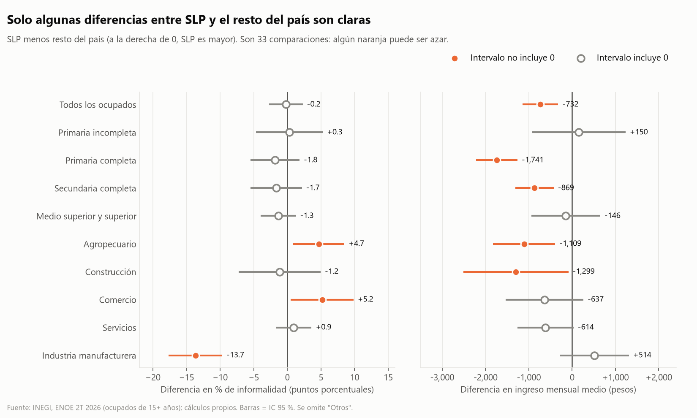

# Análisis de empleo e ingresos con datos públicos (ENOE, INEGI)

Investigación personal sobre datos del INEGI y cómo afectan a un estado de México seleccionado: **San Luis Potosí frente al promedio nacional**, con datos de la Encuesta Nacional de Ocupación y Empleo (ENOE), segundo trimestre de 2026.

**Stack:** Python (pandas, SQLAlchemy, matplotlib), PostgreSQL 18, SQL (CTE y funciones de ventana).

## Preguntas
1. ¿Cuánto cambia el ingreso mensual de los ocupados según su escolaridad en San Luis Potosí frente al promedio nacional, con y sin ponderar por el factor de expansión?
2. ¿Qué sectores de actividad pagan más y menos en San Luis Potosí, y cómo se comparan con el país?
3. ¿Qué porcentaje de los ocupados está en informalidad en San Luis Potosí frente al país, y cómo cambia por escolaridad y sector?

## Hallazgos principales
Intervalos de confianza al 95 % calculados con el diseño muestral de la encuesta. Detalle, gráficas y limitaciones en [reports/hallazgos.md](reports/hallazgos.md).

1. **La informalidad total de SLP es prácticamente igual a la nacional:** 54.9 % frente a 55.1 % (diferencia −0.2 puntos, IC −2.7 a +2.3). Con primaria incompleta es de 87.9 % y baja a 36.6 % con medio superior o superior, el mismo patrón que en el país.
2. **La diferencia está en el sector:** en manufactura la informalidad es de 23.3 % en SLP frente a 36.6 % en el país (−13.7 puntos, IC −17.7 a −9.7).
3. **SLP gana en promedio $732 menos al mes** que el resto del país ($10,330 frente a $11,062; IC de la diferencia −$1,142 a −$322). La brecha se concentra en escolaridad baja: −$1,741 con primaria completa, sin diferencia clara con medio superior o superior.



**Validación:** la población ocupada y la tasa de informalidad de las 32 entidades coinciden exactamente con el Cuadro 5 del Boletín 503/26 de INEGI (25 de agosto de 2026).

## Datos
ENOE, segundo trimestre de 2026, tabla sociodemográfica `SDEMT`. Detalle, fecha de descarga y hash en [FUENTE.md](FUENTE.md).

## Reproducir
Requisitos: Python 3.14 y PostgreSQL 18 con una base de datos llamada `enoe`.

```bash
python -m venv .venv
.venv\Scripts\pip install -r requirements.txt
```
Copia `.env.example` a `.env` y llena tus credenciales de PostgreSQL. Descarga los datos como indica [FUENTE.md](FUENTE.md) y ejecuta en orden:

| Paso | Comando | Resultado |
|---|---|---|
| 1 | `python src/probar_conexion.py` | Verifica la conexión |
| 2 | `python src/01_cargar_raw.py` | Tabla cruda `raw.enoe_sdemt_2026t2` |
| 3 | `python src/02_limpiar.py` | Tabla limpia `clean.ocupados_2026t2` y `reports/limpieza_log.txt` |
| 4 | `python src/ejecutar_sql.py sql/00_catalogos.sql` | Catálogos para los `JOIN` |
| 5 | `python src/ejecutar_sql.py sql/01_consultas.sql` | 15 consultas SQL y `reports/resultados_consultas.md` |
| 6 | `python src/03_estadisticos.py` | Medias y percentiles con IC: `reports/estadisticos.md` |
| 7 | `python src/04_graficas.py` | Gráficas en `reports/figures/` |

## Estructura
 · `sql/` catálogos y consultas · `src/` scripts · `reports/` resultados, hallazgos y gráficas
