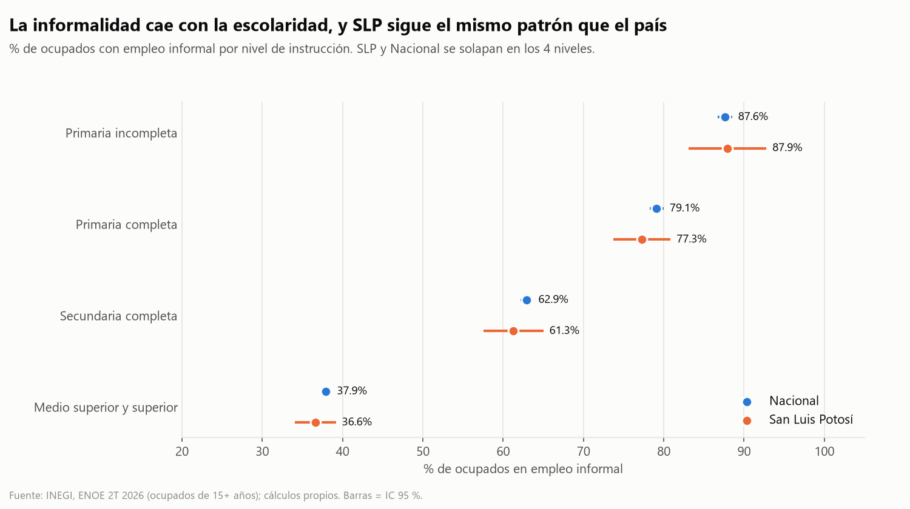
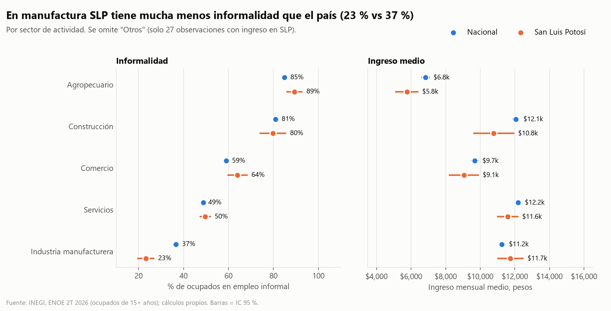
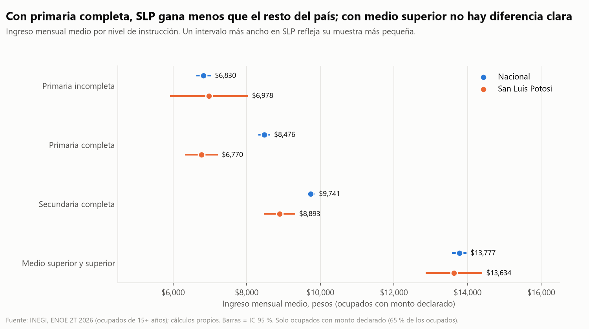

# Hallazgos y limitaciones

**Datos:** ENOE, segundo trimestre de 2026 (INEGI), ocupados de 15 años o más, con factor de expansión `FAC_TRI`.
**Comparación:** San Luis Potosí (SLP) frente al resto del país. Todos los intervalos son de confianza al 95 %, calculados con el diseño muestral de la encuesta (estratos y UPM). Detalle en [estadisticos.md](estadisticos.md).

## Hallazgo 1: la informalidad total de SLP es prácticamente igual a la del país
- **54.9 %** de los ocupados de SLP está en empleo informal (IC 52.4–57.3), frente a **55.1 %** en el país (IC 54.6–55.6).
- La diferencia entre SLP y el resto del país es de **−0.2 puntos** (IC −2.7 a +2.3): no se distingue de cero.
- El patrón por escolaridad es el mismo que en el país: la informalidad baja de **87.9 %** con primaria incompleta a **36.6 %** con medio superior o superior en SLP (87.6 % y 37.9 % a nivel nacional). En los 4 niveles los intervalos de SLP y país se traslapan.

## Hallazgo 2: la diferencia está en el sector. En manufactura SLP tiene mucha menos informalidad
- En la industria manufacturera, la informalidad es de **23.3 %** en SLP (IC 19.4–27.1) frente a **36.6 %** en el país (IC 35.4–37.7): **−13.7 puntos** respecto al resto del país (IC −17.7 a −9.7). Es la mayor diferencia de informalidad entre todos los grupos comparados.
- La manufactura emplea al 19.6 % de los ocupados de SLP frente a 16.3 % en el país (dato descriptivo, sin intervalo).
- En comercio y en el sector agropecuario SLP parece tener *más* informalidad (+5.2 y +4.7 puntos), pero sus intervalos quedan cerca de 0 (+0.5 a +9.8 y +0.9 a +8.5) y entre 33 comparaciones algún resultado así puede ser casual. Se reportan con cautela.

## Hallazgo 3: SLP gana en promedio unos $732 menos al mes, y la brecha se concentra en escolaridad baja
- Ingreso mensual medio (ocupados con monto declarado): **$10,330** en SLP (IC $9,935–$10,725) frente a **$11,062** en el resto del país. Diferencia: **−$732** (IC −$1,142 a −$322), cerca de **−6.6 %**.
- Con **primaria completa** la brecha es de **−$1,741** ($6,770 frente a $8,510; IC de la diferencia −$2,219 a −$1,262; −20.5 %), con 448 observaciones en SLP. Con **secundaria completa** es de **−$869** (−8.9 %).
- Con **medio superior o superior** la diferencia (**−$146**, IC −$939 a +$647) no se distingue de cero.

Resumen de todas las diferencias: 

## Validación contra cifras oficiales
Se compararon los resultados propios con el **Cuadro 5 del Boletín de indicador 503/26 de INEGI** (25 de agosto de 2026, página 13/16):
- Población ocupada nacional: **60,040,094** (INEGI) frente a 60.04 millones (propio). Tasa de informalidad laboral (TIL1): **55.1 %** en ambos.
- SLP: **1,329,458** ocupados y **54.9 %** de informalidad, idénticos a los publicados.
- Las **32 entidades** coinciden exactamente en población ocupada (diferencia 0) y en tasa de informalidad (0.0 puntos).

Esto valida el filtro de población, el factor de expansión y la clasificación de informalidad. No valida el ingreso ni las demás variables.

## Limitaciones
1. **Un solo trimestre.** Es una fotografía del 2T 2026: no muestra tendencias ni controla estacionalidad.
2. **Cobertura del ingreso.** Solo 65 % de los ocupados tiene un monto de ingreso declarado (60 % en SLP, 65 % a nivel nacional). Del resto, 22 % declaró solo un rango de salarios mínimos, 9 % no especificó y 4.5 % no recibe ingreso (cifras nacionales ponderadas). Si quienes no declaran difieren de quienes sí, las comparaciones de ingreso pueden estar sesgadas. No se imputó ningún valor.
3. **Valores de ingreso muy repetidos.** Los ingresos se concentran en valores como $8,600 y $12,900 (casi todos múltiplos de $2,150). Por eso se compara con la **media** y no con la mediana, cuyo intervalo puede colapsar a un solo valor. La causa de esta concentración no se verificó en la documentación de INEGI.
4. **Diccionario de otro trimestre.** El archivo de 2026 no incluye diccionario; se usó el del 4T 2025. La coincidencia exacta con el boletín valida las variables de informalidad, ocupación y el factor de expansión, pero no se pudo validar de la misma forma los códigos de escolaridad, sector ni ingreso.
5. **Muestras pequeñas.** Algunos grupos de SLP tienen pocas observaciones con ingreso (por ejemplo "Otros" sectores, 27; primaria incompleta, 189), lo que produce intervalos anchos. "Otros" se omite de las gráficas.
6. **Comparaciones múltiples.** Se hicieron 33 comparaciones al 95 %; se esperan unas 1.6 "significativas" por azar. Se destacan las diferencias lejanas de 0.
7. **Descriptivo, no causal.** No se controlan edad, sexo ni composición sectorial; las diferencias entre territorios no prueban qué las causa. Los ingresos son nominales, sin ajustar por costo de vida regional.
8. **Aproximaciones de varianza.** Se fusionaron 13 estratos con una sola UPM (de 722) y se usó el método de conglomerados últimos y un bootstrap de Rao-Wu. Los intervalos no se compararon con las tablas de precisión publicadas por INEGI.
9. **Definición de informalidad.** Corresponde al trabajo principal (TIL1 de INEGI); no incluye trabajos secundarios.
